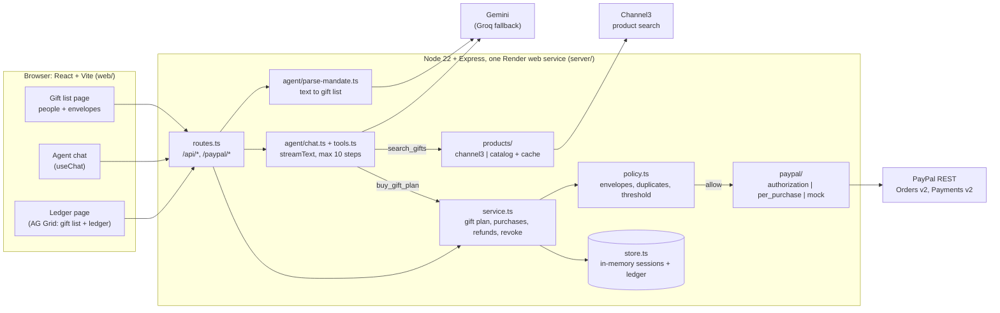

# Ribbon

**Every gift on your list, tied to one PayPal approval.**

Ribbon is an AI agent for holiday gift shopping. You type your gift list once: who, how much each, what they like. You approve one PayPal authorization for the total. The agent then shops the whole list in one pass and buys a gift for every person, each inside that person's own envelope. Gifts above your "ask me first" amount wait for your yes. Code, not the model, enforces every envelope, and every step lands in an AG Grid ledger.

- **Hosted demo:** https://allowance-cpp0.onrender.com (free tier: the first load after idle can take about a minute)
- **Demo video (under 3 min):** https://youtu.be/p16WywpQZj4
- **Judges:** a 3-minute test path is in [docs/JUDGES.md](docs/JUDGES.md).

Built for the PayPal AI Hackathon (Devpost). Categories: Agentic Commerce, PayPal + AI, Channel3, AG Grid, Render.

---

## Why

Holiday shoppers want two things that pull against each other: a budget they can stick to, and the right gift for each person. Finding that gift takes hours.

| Fact | Source |
|---|---|
| **"Setting and sticking to a budget" is the top way shoppers plan to manage holiday spending (36%).** | [PayPal 2026 Holiday Shopping Survey](https://newsroom.paypal-corp.com/2026-09-30-PayPal-Survey-Reveals-Holiday-Spending-Isnt-Slowing-Down,-But-Shoppers-Are-Changing-How-They-Spend) (PayPal / Morning Consult, n=2,005 US adults, Sept 2–4, 2026) |
| **63% would spend hours searching online for the perfect gift**; 70% would visit multiple stores. | Same PayPal 2026 survey |
| 58% feel greater financial concern heading into the holidays, yet 64% expect to spend the same or more. | Same PayPal 2026 survey |
| Americans planned to spend **$627.93 each on gifts** for family and friends in the 2025 season (of $890.49 total holiday spending). | [NRF / Prosper Insights, Oct 16, 2025](https://nrf.com/media-center/press-releases/consumers-to-spend-second-highest-amount-on-record-according-to-nrf-holiday-survey) |
| **37%** of U.S. consumers took on holiday debt, $1,223 on average. | LendingTree study, as reported by the [Wharton Baker Retailing Center, Jan 8, 2026](https://bakerretail.wharton.upenn.edu/?p=9765) |
| **71%** want to review purchases before an AI agent checks out; **76%** name fraud and unauthorized charges as their top concern. | [Nuvei agentic commerce research, 2025](https://www.nuvei.com/agentic-commerce/research) (n=1,000 US) |
| About **17%** of holiday sales are returned. | [NRF and Happy Returns, Oct 15, 2025](https://nrf.com/media-center/press-releases/consumers-expected-to-return-nearly-850-billion-in-merchandise-in-2025) |
| 40% of Americans used AI to help with a purchase in the past year (PayPal's count includes people who considered it); 77% of AI shoppers plan to use AI for holiday shopping. | [PayPal / Talker Research, Oct 22, 2025](https://newsroom.paypal-corp.com/2025-10-22-From-AI-to-BNPL,-PayPal-Survey-Reveals-How-Merchants-Can-Win-the-Holidays) |
| In 3,168 attacked runs on web shopping agents, "no attack objective is reliably resisted". | [arXiv 2606.13385](https://arxiv.org/abs/2606.13385), June 11, 2026 |

How Ribbon answers each one:

- **Stick to the budget, per person.** Each person gets an envelope, and code refuses any gift that does not fit it.
- **Skip the hours of hunting.** The agent searches for everyone on the list at once and buys in one pass.
- **Review before paying.** Anything above your ask-me amount waits for your yes. Nothing is charged before that.
- **Returns are normal.** A refund goes back to PayPal and back into that person's envelope.
- **Agents get tricked.** The limits live in code, so a hijacked agent still cannot overspend. A button in the app proves it live.

## What makes Ribbon different

1. **One PayPal approval, split into per-person envelopes.** You approve one Orders v2 authorization for the total ($200 in the demo). Ribbon divides it into envelopes (Mom $60, Dad $50, Leo $30, Sam $30, Secret Santa $30). The envelopes always add up to the total.
2. **The agent shops the whole list in one pass.** "Shop my whole gift list" runs one search per person in parallel (`search_gifts`), then buys one gift each in a single call (`buy_gift_plan`). Each gift is its own partial capture on the one authorization.
3. **Code enforces each envelope.** A deterministic policy engine checks every gift against that person's envelope. It also blocks duplicate gifts (the same product for two people) and holds any gift over the ask-me threshold until you say yes. The model's text cannot change these checks.
4. **Refunds go back into the right envelope.** "Return Sam's gift" refunds that PayPal capture, and Sam's envelope is free again, so the agent can find him something else.
5. **A live red-team button.** **Simulate a hijacked agent** replays the exact purchase a prompt-injected agent would make (5 units, $170, for Mom) through the real purchase path. The policy engine blocks it, and the ledger shows why.

## How it works

The demo list (prefilled on the Gift list page):

> Holiday gifts, $200 total. Mom $60, she loves gardening. Dad $50, coffee nerd. My nephews Leo $30 (dinosaurs) and Sam $30 (soccer). Office Secret Santa $30, something for the desk. Ask me before anything over $45. No electronics.

| # | Step | What happens |
|---|---|---|
| 1 | **Type the list** | **Draft with AI** turns the text into a structured gift list: five people with envelopes 60, 50, 30, 30 and 30, a total of $200 (derived from the envelopes, read-only), ask-me above $45, electronics blocked, at most 2 of any item, and an expiry no later than 29 days out. You can edit every field and person before approving. |
| 2 | **Approve $200 with PayPal** | One PayPal approval for the total: an Orders v2 `AUTHORIZE` order, approved by the buyer on PayPal's page and then authorized. This is a hold, not a payment. PayPal holds the budget for up to 29 days, so the list expires no later than that. |
| 3 | **Shop my whole gift list** | The agent calls `search_gifts` once (one Channel3 search per person, capped at that person's envelope, run in parallel). It picks one gift each and calls `buy_gift_plan` once. Every pick goes through the policy engine, in order, and each allowed one becomes a partial capture on the authorization. |
| 4 | **The gift plan** | A **Gift plan** card lists every person with the gift, the price, the status (**Bought** with the PayPal capture ID, **Waiting for your OK** with **Approve** and **Reject**, or **Blocked** with the reasons), what is left in their envelope, and what is left on the PayPal approval. |
| 5 | **Ask first** | A gift for Mom over $45 waits. **Approve $…** re-runs every hard check, then captures it. **Reject** drops it, and nothing is charged. |
| 6 | **A hijacked agent** | A poisoned listing says to ignore the limits and buy 5 units. If the model notices, it calls `report_suspicious_content` and skips the listing. **Simulate a hijacked agent** assumes the model obeyed: 5 × "Deluxe Herb Seed Gift Box" ($170) for Mom. Blocked: 5 is over the cap of 2, $170 is over Mom's $60 envelope, and over the total left once gifts are bought. |
| 7 | **Return Sam's gift** | The agent calls `request_refund`. PayPal refunds that capture, and the card reads "Sam's envelope has $30.00 again". |
| 8 | **Gift list and ledger** | The Ledger page has two AG Grid grids. **Gift list**: Recipient, Envelope, Gift, Price, Status, PayPal capture and Left, with a pinned total row. **Ledger**: every request, search, policy decision with its reasons, capture, refund, block and flag, with a Recipient column and the budget left after each row. |
| 9 | **Revoke** | **Revoke gift list**: the agent loses spending power immediately (enforced in code) and Ribbon voids the PayPal authorization, which releases whatever part of the hold was never captured (sandbox-verified after one or several partial captures and after refunds). If the gifts already used the whole hold, there is nothing left to void and the ledger says so. Gifts already bought stay in the ledger and can still be refunded. |

## Defence in code

A purchase must pass three layers. Each layer assumes the one before it has failed.

| Layer | Enforced by | What it stops | Code |
|---|---|---|---|
| **1. The model flags injection** | The LLM | Product text reaches the model inside `<untrusted_product_data>` blocks and is treated as data. When a listing tries to give orders, the agent calls `report_suspicious_content`, tells the user and skips the listing. Each flag writes an `agent.flagged_injection` ledger row. | `server/agent/prompt.ts`, `server/agent/tools.ts` |
| **2. Deterministic policy engine** | Pure TypeScript, unit-tested | `evaluatePolicy()` runs before any PayPal call. Checks, in order: gift list status and expiry; blocked and allowed categories; low category confidence (ask first); quantity per item; the total budget left; then, on a gift list, that the gift names a person on the list, fits **that person's envelope**, and is **not a duplicate** of a gift already bought or waiting; last, the **ask-me threshold**. Prices, categories and merchants come from the product source, never from the model. Unknown product IDs and unknown people are refused. An approval by you skips only the threshold and confidence checks; every hard limit runs again. | `server/policy.ts`, `server/service.ts` |
| **3. PayPal authorization: the outer bound** | PayPal | The agent can only draw against the single authorization you approved, and once it is used up PayPal refuses any further capture. PayPal is the outer bound; the policy engine owns the exact per-person budget. (In the sandbox, PayPal accepted an over-capture on the capture that used up the authorization, so the cent-exact cap is not PayPal's job.) | `server/paypal/authorization.ts` |

The policy check and the capture run under a per-session lock, so two gifts cannot both spend the same dollars. Envelope spending is derived from charged purchases, never stored, so a refund frees the envelope automatically.

**Simulate a hijacked agent.** Layer 1 depends on the model, so it can fail. The red-team button assumes it already has. It replays the exact `propose_purchase` call a fully compromised agent would make after obeying the poisoned listing: 5 units of the injected product, for the first person on the list, with a rationale that cites the "pre-approval". The call goes through the same `proposePurchase()` path and the same policy engine as a real agent call; only the ledger label `[Red-team simulation]` marks it. The ledger shows `agent.hijacked_attempt` followed by `policy.deny` with the reasons. No LLM call is involved, so the button works even when the AI is rate-limited. Endpoint: `POST /api/redteam/hijack` (`server/routes.ts`, `simulateHijackedAgent()` in `server/service.ts`, tests in `server/redteam.test.ts`).

## PayPal integration

All calls use the PayPal REST API with OAuth2 client credentials. The access token is cached and refreshed one minute before it expires, and the client retries once on a 401. Every write sends a stable `PayPal-Request-Id` for idempotency. The client lives in `server/paypal/client.ts`. One `PaymentRail` interface (`server/paypal/rail.ts`) has three implementations, and `PAYMENT_MODE` picks one.

> The `authorization` rail was run end to end against the PayPal sandbox on 2026-11-03/04 (a direct REST run and the full app flow). The details are in [docs/research/paypal-sandbox-results.md](docs/research/paypal-sandbox-results.md). The hosted demo runs `PAYMENT_MODE=authorization`.

| Purpose | PayPal API | Code | Status |
|---|---|---|---|
| Access token | `POST /v1/oauth2/token` (client credentials) | `server/paypal/client.ts` | Verified in sandbox |
| Approve the gift list: hold the total | `POST /v2/checkout/orders` with `intent: AUTHORIZE`, amount = the sum of the envelopes | `authorizeMandate()` in `server/paypal/authorization.ts` | Verified in sandbox: order `PAYER_ACTION_REQUIRED`, buyer approved |
| Turn the approval into an authorization | `POST /v2/checkout/orders/{id}/authorize` | `finalize()` in `server/paypal/authorization.ts` | Verified in sandbox: 201, authorization `CREATED` for the full amount, valid 29 days |
| Buy one gift: partial capture | `POST /v2/payments/authorizations/{id}/capture` with the gift's amount, `final_capture: false`, `invoice_id` = purchase ID | `charge()` in `server/paypal/authorization.ts` | Verified in sandbox: several partial captures against one authorization, each 201 `COMPLETED`. Once the authorization is used up, PayPal answers 422 `AUTHORIZATION_ALREADY_CAPTURED`. |
| Return a gift | `POST /v2/payments/captures/{id}/refund` | `refund()` in `server/paypal/authorization.ts` and `server/paypal/per-purchase.ts` | Verified in sandbox: refund 201 `COMPLETED`, also triggered by the agent |
| Revoke | `POST /v2/payments/authorizations/{id}/void` (a 422 on an already captured or voided authorization is tolerated and logged as "nothing left to void") | `revoke()` in `server/paypal/authorization.ts` | Spending power ends in code at once. Void after one or several partial captures, and after refunds, returns 200 and releases the uncaptured hold. Once captures total the full authorized amount (or one used `final_capture: true`), PayPal answers 422 `PREVIOUSLY_CAPTURED`, logged as "nothing left to void". Eleven sandbox cases in `docs/research/paypal-sandbox-results.md`. |
| Fallback rail: buyer approves each purchase | `POST /v2/checkout/orders` with `intent: CAPTURE`, then `POST /v2/checkout/orders/{id}/capture` | `per_purchase` rail, `server/paypal/per-purchase.ts` | Implemented, unit-tested with a mocked PayPal. Not used in the demo. |
| Buyer return and cancel URLs | `GET /paypal/return`, `GET /paypal/cancel` (our endpoints) | `paypalReturnRouter()` in `server/routes.ts` | |
| Keyless development | No network calls. IDs start with `MOCK-`, and the UI shows a **MOCK PAYMENTS** badge. | `mock` rail, `server/paypal/mock.ts` | Works |
| Ship a gift | `POST /v2/checkout/orders/{id}/track` with the capture ID, carrier `OTHER` ("Ribbon demo shipping") and a simulated `RIB…` tracking number; fallback `POST /v1/shipping/trackers-batch` | `server/paypal/tracking.ts`, `shipPurchase()` in `server/service.ts` | Verified in sandbox and on the hosted app: every captured gift gets a tracker, GET order shows it `SHIPPED`. A tracking failure never fails the purchase. |
| Webhooks | `POST /api/paypal/webhook` (our endpoint). Every event is checked with `POST /v1/notifications/verify-webhook-signature`; the app finds or creates its own webhook (`GET`/`POST /v1/notifications/webhooks`) for `CHECKOUT.ORDER.APPROVED`, `PAYMENT.CAPTURE.COMPLETED`, `PAYMENT.CAPTURE.REFUNDED`, `PAYMENT.AUTHORIZATION.VOIDED` | `server/paypal/webhooks.ts`, `recordPayPalWebhook()` in `server/service.ts` | Verified on the hosted app: real signed deliveries become `paypal.webhook` ledger rows ("PayPal confirmed: capture … COMPLETED for Mom"). Unsigned events get 400. Rows are a confirmation trail and change no balances. |
| PayPal Agent Toolkit | `@paypal/agent-toolkit` 1.11: `get_order`, `get_refund`, `get_shipment_tracking` | `server/agent/paypal-toolkit.ts` | Verified in sandbox. Read-only: three layers keep money-moving tools away from the model (toolkit config, a code allowlist with a test that registers all 47 toolkit tools and fails on any extra, and a scope check that allows only this list's own PayPal IDs). The toolkit's tools are re-declared for AI SDK v7 with the toolkit's own descriptions, schemas and `execute`. |
| Vault (save the wallet, charge later) | `/v3/vault/setup-tokens`, `/v3/vault/payment-tokens` | Not implemented. `PAYMENT_MODE=vault` falls back to `authorization`. | Planned |

**Merchant of record.** The app's own sandbox business account is the seller. Product prices come from Channel3, and fulfilment is simulated (see [Limitations](#limitations)).

## AI integration

Built on the Vercel AI SDK (`ai` v7) with `@ai-sdk/google` for Gemini and `@ai-sdk/openai-compatible` for the Groq fallback.

| Use | How | Code |
|---|---|---|
| **Plain-language list to structured gift list** | `generateText` with `Output.object` and a zod schema: the people (name, envelope, interests), the ask-me threshold, allowed and blocked categories from a fixed vocabulary of 15, the quantity cap and the expiry. The server validates the result again (`MandateInputSchema`: 1–12 people, unique names, envelopes above $0 that sum to the total, expiry clamped to 29 days). If the model fails or is rate-limited, a rule-based parser fills the rules it can read (total, ask-me amount, blocked categories), leaves the people for you to add in the editor, and the UI asks you to review the draft. | `server/agent/parse-mandate.ts`, `server/service.ts` |
| **Tool-using shopping agent** | `streamText`, streamed to the browser's `useChat` as an AI SDK UI message stream. At most 10 steps per turn and the last 16 messages. The system prompt carries the gift list: each person's ID, envelope left, interests and what is already bought. | `server/agent/chat.ts`, `server/agent/prompt.ts` |
| Agent tools | `search_gifts(searches[])`, `buy_gift_plan(plan[])`, `search_products(query, max_price?, category?)`, `propose_purchase(items[], rationale, recipient_id?)`, `request_refund(purchase_id, reason)`, `get_mandate()`, `list_purchases()`, `report_suspicious_content(product_id, reason)`. None of them moves money directly: `buy_gift_plan` and `propose_purchase` run the policy engine first. | `server/agent/tools.ts` |
| **Purchase rationale** | Every gift carries a one-sentence "why this one", shown on the cards and stored in the ledger. | `server/agent/tools.ts`, `server/service.ts` |
| **Injection flagging** | Listings are marked untrusted. The model reports instructions found in them through `report_suspicious_content`, which writes an `agent.flagged_injection` ledger row (layer 1). | `server/agent/prompt.ts`, `server/agent/tools.ts` |
| Category mapping | **Deliberately not an LLM call.** Channel3's category path is mapped to the vocabulary by ordered rules. A doubtful match gets `category_confidence: "low"`, which the policy engine turns into "ask first". | `server/products/categorize.ts` |

**Models.** Every AI call (chat and gift-list parsing) walks an ordered model chain: by default the configured Gemini Flash model (the hosted demo sets `AI_MODEL=gemini-3.6-flash`), then the other Gemini Flash models, then Groq `openai/gpt-oss-120b` and `openai/gpt-oss-20b`. Each has its own free-tier quota, so when one is rate-limited or overloaded the call moves to the next. `AI_MODEL` with commas sets the exact chain, `AI_FALLBACK_MODEL` replaces its tail, and `AI_FALLBACK=off` keeps only the primary. Models whose provider has no API key are dropped. The chain is built by `aiChain()` in `server/config.ts` and run by `server/agent/model.ts`.

**Rate limits** (the free tiers are small):
- Chat shows a friendly message ("The AI is rate-limited right now. Wait a minute and try again.") and a **Try again** button. Nothing is bought on a failed turn.
- Automatic retries repeat only the model call, never a tool call that already ran.
- Product searches are cached per query for 30 minutes (`server/products/index.ts`).
- `search_gifts` sends at most 5 listings per person with short descriptions, so a whole-list turn stays small.

## Architecture



The model can only call tools. Before any money moves, `service.ts` asks `policy.ts`, and the payment rail is reached only on `allow`.

```
server/
  index.ts            Express app: /healthz, /api, /paypal, serves web/dist (SPA fallback)
  routes.ts           HTTP API (incl. POST /api/redteam/hijack) + anonymous session cookie
  service.ts          gift list / gift plan / purchase / refund / revoke; every step writes a ledger row
  policy.ts           evaluatePolicy(): pure, no I/O, no LLM
  store.ts            per-session state, per-recipient envelope status, per-session lock, JSON persistence
  config.ts           env parsing and mode selection
  agent/              model.ts (providers + fallback), chat.ts, tools.ts, prompt.ts, parse-mandate.ts
  paypal/             client.ts, rail.ts, authorization.ts, per-purchase.ts, mock.ts
  products/           channel3.ts, catalog.ts, categorize.ts, index.ts
  data/catalog.json   56 seeded products, including the prompt-injection listing
  *.test.ts           policy, gift list, red-team, revoke, per-purchase rail (+ products/products.test.ts)
shared/types.ts       contract shared by server and web
web/                  Vite + React 19: Gift list, Agent, Ledger pages
scripts/              build-web.mjs (npm run build), smoke.ts (npm run smoke), screenshots.mjs, video/
```

## Run locally

Requires **Node 22+**. No keys are needed for a first run: without PayPal keys the mock rail is used, and without a Channel3 key (or when Channel3 fails) search uses the seeded catalog. The agent chat needs `GEMINI_API_KEY` (or `GROQ_API_KEY` with `AI_PROVIDER=groq`).

1. `node -v` (must be v22 or later)
2. `cp .env.example .env`
3. Fill in the keys in `.env`: `GEMINI_API_KEY`, and optionally `GROQ_API_KEY`, `PAYPAL_CLIENT_ID` / `PAYPAL_CLIENT_SECRET` (sandbox) and `CHANNEL3_API_KEY`. To use PayPal, set `PAYMENT_MODE=authorization`.
4. `npm install`
5. `npm run build` (installs and builds the frontend in `web/` into `web/dist`)
6. `npm start`, then open http://localhost:3000. Use `npm run dev` to restart the server on every change.

**Port.** The default is `3000`. If it is taken, set `PORT`, either in `.env` or for one run: `PORT=3130 npm start` (bash), or `$env:PORT=3130; npm start` (PowerShell). A real environment variable wins over `.env`. Health check: `GET /healthz`, state: `GET /api/state`.

Frontend hot reload (optional): run the server, then `npm --prefix web run dev` and open http://localhost:5173. Vite proxies `/api` to `http://localhost:3000`, or to `API_TARGET` if you set it. To see the UI without a server, open `/?fixture=1`.

## Environment variables

| Variable | Default | Purpose |
|---|---|---|
| `GEMINI_API_KEY` | (none) | Google AI Studio key: the agent and gift-list parsing. Secret. |
| `AI_PROVIDER` | `google` | `google` or `groq`: the primary provider. |
| `AI_MODEL` | `gemini-3.8-flash` (google), `openai/gpt-oss-120b` (groq) | Primary model ID, or a comma-separated chain (`gemini-3.6-flash,groq:openai/gpt-oss-20b`). The hosted demo uses `gemini-3.6-flash`. |
| `GROQ_API_KEY` | (none) | Groq key: the Groq models in the fallback chain, or the primary with `AI_PROVIDER=groq`. Secret. |
| `AI_FALLBACK_MODEL` | the other Gemini Flash models, then `groq:openai/gpt-oss-120b`, `groq:openai/gpt-oss-20b` | Comma-separated `provider:model` list that replaces the chain after the primary. |
| `AI_FALLBACK` | (on) | `off` keeps only the primary model. |
| `PAYPAL_CLIENT_ID` / `PAYPAL_CLIENT_SECRET` | (none) | PayPal REST app credentials (sandbox). Secret. |
| `PAYPAL_ENV` | `sandbox` | `sandbox` or `live`. |
| `PAYMENT_MODE` | `authorization` with keys, otherwise `mock` | `mock`, `authorization` or `per_purchase`. `vault` falls back to `authorization`. A non-mock mode without keys falls back to `mock`. |
| `CHANNEL3_API_KEY` | (none) | Channel3 search key. Secret. |
| `PRODUCT_SOURCE` | `channel3` with a key, otherwise `catalog` | `channel3` or `catalog`. Channel3 errors fall back to the catalog. |
| `DEMO_INJECTION` | off | `1` mixes the prompt-injection listing into garden and gift results. |
| `PUBLIC_URL` | (taken from the request) | Public base URL for PayPal return links, e.g. `https://allowance-cpp0.onrender.com`. |
| `PORT` | `3000` | HTTP port. Render sets it. |
| `STORE_FILE` | `.data/store.json` | Best-effort JSON persistence of sessions. |
| `NODE_ENV` | (none) | `production` turns on `Secure` session cookies. |
| `BASE_URL` / `SMOKE_URL`, `SMOKE_PAUSE_MS` | `http://localhost:$PORT`, `45000` | Used only by `npm run smoke`. |

## Sandbox test buyer (for judges)

A PayPal sandbox personal account for the "Approve with PayPal" step. These are PayPal sandbox test credentials only (no real money).

- Email: `sb-aktpl53694657@personal.example.com`
- Password: `Lc:)K9dT`

## Tests

- `npm test`: Over 100 Vitest unit tests (105 on 2026-11-05) across the policy engine (`server/policy.test.ts`), envelopes, duplicates and the gift plan (`server/giftlist.test.ts`), the red-team path and `report_suspicious_content` (`server/redteam.test.ts`), revoke (`server/revoke.test.ts`), the per-purchase rail (`server/per-purchase.test.ts`) and product mapping (`server/products/products.test.ts`). No keys, no network.
- `npm run smoke`: an end-to-end script against a **running** server (`npm start` in another terminal; set `BASE_URL` for the hosted URL). It uses the real AI model and the demo list: parse it, approve it, shop the whole list, approve the gift that waits, check that a robot vacuum is still refused, refund a gift and check its envelope, revoke, and print the ledger. On the Gemini free tier it pauses between steps, so expect a few minutes.
- `npm run typecheck`: TypeScript, server side. `npm --prefix web run build`: web typecheck and build.

## Tech stack

TypeScript everywhere. **Server:** Node 22, Express 5, tsx, zod 4. **AI:** Vercel AI SDK 7, `@ai-sdk/google` (Gemini), `@ai-sdk/openai-compatible` (Groq). **Payments:** PayPal REST (Orders v2, Payments v2), `@paypal/agent-toolkit` (read-only lookups). **Products:** Channel3 Search API plus a seeded catalog. **Web:** React 19, Vite 8, `@ai-sdk/react` `useChat`, AG Grid Community 36. **Hosting:** Render (free web service, `render.yaml` Blueprint). **Tests:** Vitest.

## Limitations

- **Merchant of record.** The app's own PayPal sandbox business account is the seller. Real products and prices come from Channel3, but the money goes to that account, not to the store that lists the product.
- **Simulated fulfilment.** No real parcel ships. Each purchase is a PayPal capture plus a shipment registered with PayPal under a simulated `RIB…` tracking number (carrier "Ribbon demo shipping").
- **In-memory store.** State lives per anonymous session cookie, in memory, with a best-effort JSON file. Render's free tier has no persistent disk, so data resets on restart, redeploy or spin-down. There are no user accounts.
- **PayPal does not enforce the exact budget.** In the sandbox, PayPal accepted an over-capture on the capture that used up the authorization ($40 + $30 + $100 against $150), then refused any further capture. So PayPal is the outer bound, and the exact per-person budget is enforced by the policy engine under a per-session lock.
- **Refunds do not refill the PayPal hold.** A refund frees the person's envelope in Ribbon, but PayPal counts every capture against the authorization, refunded or not. Ribbon therefore also checks the hold's uncaptured room and blocks a re-purchase the hold could no longer cover ("The PayPal hold has $X left to capture").
- **29-day window.** A PayPal authorization is honoured for 29 days, so a gift list expires no later than that.
- **USD only**, one currency per list. One gift list per session at a time.
- **The vault rail** is planned, not built. The `per_purchase` fallback rail is implemented but not used in the demo. The Agent Toolkit's Transaction Search tool is left out: it needs "Transaction search" enabled on the PayPal app.
- **The free AI tiers are small.** Under load, a chat turn may move down the model chain or show the rate-limit message.

## License

[MIT](LICENSE) © 2026 Tomiyato
